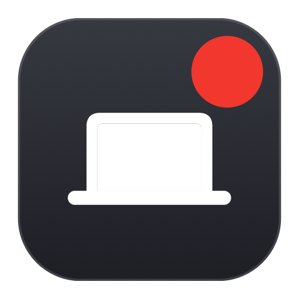
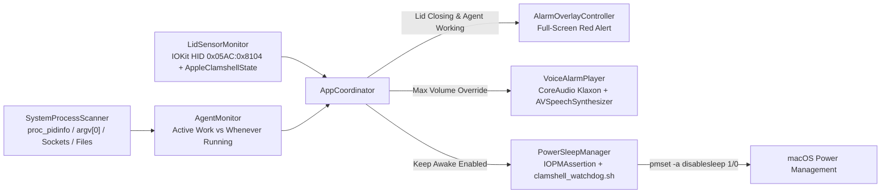

<div align="center">



# DontCloseMe

**Native macOS AI Agent Lid & Sleep Guardian**

Protect running AI coding agents from accidental MacBook lid closures with real-time HID lid-angle alarms, non-bypassable CoreAudio alerts, and safe clamshell sleep prevention until tasks complete.

[](https://www.apple.com/macos/)
[](https://swift.org)
[](LICENSE)
[](https://github.com/Mealiclay01/DontCloseMe/actions/workflows/ci.yml)

</div>

---

## Why DontCloseMe?

Long-running AI coding sessions—multi-file refactors, test loops, migrations, and subagent runs—often run unattended in a terminal or IDE. Closing your MacBook lid out of habit immediately suspends processes, drops streaming LLM sockets, and corrupts or stalls active agent state.

**DontCloseMe** sits quietly in your macOS Menu Bar and solves this at the hardware and kernel power level:

1. **Knows when an AI agent is actually working** (versus merely sitting idle at a prompt).
2. **Screams before the lid shuts** using Apple Silicon's hardware HID lid-angle sensor, a multi-display pulsing red alert, a CoreAudio klaxon that overrides Mute/Volume-Down keys, and spoken voice warnings.
3. **Keeps the Mac working even if the lid is closed**, then automatically restores normal macOS sleep as soon as your AI agents finish.

---

## Key Features

### 1. Real-Time Hardware Lid-Closing Alarm
- **Direct IOKit HID Sensor Reading:** Reads your MacBook's real-time HID Lid Angle Sensor (`0x05AC:0x8104`, usage page `0x0020`, usage `0x008A`) alongside an `IOPMrootDomain` (`AppleClamshellState`) fallback.
- **Angle & Velocity Triggers:** Fires immediately when the lid crosses your configured trigger angle (default **`85°`**) or detects a fast downward closing swing while a guarded agent is active.
- **Multi-Display Red Overlay:** Displays a synchronized full-screen crimson alert (`"STOP. DO NOT CLOSE ME."`) across all connected screens with rotating messages naming the active agent and a live lid-angle gauge.
- **Auto-Dismiss on Reopen:** Lifting the lid back open automatically silences the alarm and clears the overlay.

### 2. Volume-Override Klaxon & Voice Alert
- **Hardware Volume Protection (`SystemVolumeOverride` via CoreAudio):** Captures your current output volume and mute state on alarm start, unmutes audio, and enforces `100%` system output volume every `0.2s` so accidental Volume Down or Mute key presses cannot silence an active lid alert.
- **Synthesized Audio + Voice:** Drives a soft-saturated dual-tone klaxon (`960/1440 Hz` & `720/1080 Hz`) paired with `AVSpeechSynthesizer` spoken warnings.
- **Clean State Restoration:** Automatically restores your exact previous volume and mute state the moment you dismiss, snooze, or reopen the lid.

### 3. Clamshell Work Mode ("Keep Working When Lid Closed")
- **Toggleable Guard Mode:** Switch directly from the Menu Bar popover or the **Monitor** tab:
  - **OFF (Alarm-Only Mode):** Alerts you when closing the lid, while letting macOS sleep normally if shut completely.
  - **ON (Keep Working Until AI Finishes):** Holds standard `IOPMAssertion` locks (`PreventUserIdleSystemSleep` + `PreventSystemSleep`) and, once authorized via the one-time macOS Touch ID / password prompt, runs [`clamshell_watchdog.sh`](Sources/DontCloseMe/Resources/clamshell_watchdog.sh) to manage `pmset -a disablesleep 1` while agents are active.
- **Automatic Restore & Battery Safety Floor:** Automatically restores `pmset -a disablesleep 0` (and optionally invokes `pmset sleepnow` if the lid is closed) as soon as all guarded agents finish working, if unplugged battery drops below the safety floor (default **`12%`**), or if `DontCloseMe.app` exits or crashes.

### 4. Deep AI Agent Activity Detection
Instead of naively keeping your Mac awake whenever an editor window is left open, **Active Work Only** mode inspects four live signals across the process tree:
- **Process Tree Matching:** Matches resolved paths, `argv[0]` basenames (crucial for versioned symlinks like `~/.local/bin/claude -> ~/.local/share/claude/versions/*` and Node wrapper scripts like `~/.opencode/cli.mjs`), `pbi_comm`, and command arguments while explicitly excluding system services (`CursorUIViewService`, `/System/`, `/usr/libexec/`).
- **Descendant CPU & Child Spawns:** Tracks descendant process-tree CPU% and newly spawned child commands (`< 25s`).
- **Active Network Sockets & Deep Session Files:** Checks active LLM TCP connections and traverses session directories up to depth 5 sorted by newest modification time (such as `~/.codex/sessions/YYYY/MM/DD/...` and Claude project/debug logs).
- **Flexible Overrides:** Switch globally to **Whenever Running**, or click **Pin (Always Guard)** on any individual agent card to protect even idle prompts.

---

## Supported AI Agents (14 Built-In Profiles + Custom)

| Agent | Category | Monitored Signals |
| :--- | :--- | :--- |
| **Claude Code** | CLI | `claude` (`argv0`), `~/.local/share/claude/`, `~/.claude/{projects,debug,sessions,history.jsonl}` |
| **Codex** | CLI / App | `codex`, `@openai/codex`, `Codex.app`, `~/.codex/{sessions,log}` |
| **OpenCode** | CLI / App | `opencode`, `opencode/cli.mjs`, `~/.local/share/opencode/`, `~/.opencode` |
| **Cursor** | Editor / IDE | `Cursor.app`, `cursor-agent`, `~/.cursor/{projects,chats}` *(excludes `CursorUIViewService`)* |
| **Antigravity** | Editor / IDE | `Antigravity.app`, `language_server`, `~/.gemini/antigravity/{brain,conversations}` |
| **Aider** | CLI | `aider`, `aider-chat`, `~/.aider` |
| **Gemini CLI** | CLI | `gemini`, `@google/gemini-cli`, `~/.gemini/tmp` |
| **Goose** | CLI | `goose`, `~/.local/share/goose` |
| **Windsurf** | Editor / IDE | `Windsurf.app`, `language_server_macos_*`, `~/.codeium/windsurf` |
| **VS Code / Copilot / Cline** | Editor / IDE | `copilot-language-server`, `github.copilot`, `claude-dev`, `roo-cline`, `continue` |
| **Kiro / Trae / Devin / ZCode** | Editor / IDE | `Kiro.app`, `Trae.app`, `Devin.app`, `ZCode.app` |
| **Claude Desktop** | Desktop | `Claude.app` |
| **OpenClaw / Hermes / Eigent** | Desktop | `OpenClaw.app`, `Hermes.app`, `Eigent.app`, `DeepSeek Harness.app` |
| **Ollama / Local LLM** | Local Model | `ollama`, `llama-server`, `mlx_lm.server`, `Ollama.app` |
| **Custom Agents** | Custom | User-defined executables, command substrings, or watched paths in **Watched Tools** |

---

## Architecture



---

## Quick Start

### Requirements
- **macOS 14.0 (Sonoma)** or later (Apple Silicon recommended for HID lid-angle telemetry; `IOPMrootDomain` clamshell fallback works across Macs)
- **Swift 5.10+** / Xcode Command Line Tools (`xcode-select --install`)

### Build, Test & Launch

```bash
git clone https://github.com/Mealiclay01/DontCloseMe.git
cd DontCloseMe

# Run the unit test suite
swift test

# Compile release binary, generate AppIcon.icns, package & sign DontCloseMe.app
./build_app.sh

# Launch the app
open build/DontCloseMe.app
```

To install permanently into `/Applications`, open the **Settings** tab inside the app and click **Install** under **Copy to /Applications** (or copy `build/DontCloseMe.app` manually).

---

## Repository Structure

```text
DontCloseMe/
├── Package.swift                               # SwiftPM manifest (macOS 14+, Apple system frameworks)
├── build_app.sh                                # Release compiler, icon builder, .app bundler & codesigner
├── Packaging/
│   ├── Info.plist                              # Bundle metadata (com.anas.dontcloseme)
│   └── generate_icon.swift                     # Programmatic AppKit vector-to-iconset renderer
├── Sources/DontCloseMe/
│   ├── DontCloseMeApp.swift                    # SwiftUI App entry point & MenuBarExtra
│   ├── Models/
│   │   └── AgentModels.swift                   # Built-in agent profiles, AppSettings & phrase templates
│   ├── Services/
│   │   ├── AgentMonitor.swift                  # Activity state machine (Idle / Working / Finishing)
│   │   ├── SystemProcessScanner.swift          # Darwin libproc scanner, CPU tree & socket/file probes
│   │   ├── LidSensorMonitor.swift              # IOKit HID lid-angle & clamshell state monitor
│   │   ├── PowerSleepManager.swift             # IOPMAssertion & privileged watchdog coordinator
│   │   ├── AlarmOverlayController.swift        # Multi-display emergency NSPanel controller
│   │   ├── VoiceAlarmPlayer.swift              # CoreAudio volume lock, klaxon synth & speech alert
│   │   └── AppCoordinator.swift                # Central orchestration & activity logging
│   ├── UI/
│   │   ├── DashboardView.swift                 # Main 4-tab window (Monitor, Watched Tools, Settings, Log)
│   │   ├── MenuBarPopoverView.swift            # Compact Menu Bar control surface
│   │   ├── AlarmOverlayView.swift              # Pulsing crimson emergency UI
│   │   └── LidGaugeView.swift                  # Live hardware lid-angle indicator
│   └── Resources/
│       ├── clamshell_watchdog.sh               # Failsafe pmset watchdog with battery & PID guards
│       └── launch_watchdog.sh                  # Detached background launcher
├── Tests/DontCloseMeTests/
│   └── DontCloseMeTests.swift                  # Unit tests (symlinks, wrappers, exclusions, watchdog)
└── assets/
    └── logo.png                                # Application icon rendered at 512x512
```

---

## Privacy & Safety

- **Zero Telemetry:** DontCloseMe never transmits process lists, commands, file paths, or usage metrics outside your Mac.
- **No Unbounded Wake Locks:** The watchdog tracks `DontCloseMe.app`'s PID directly and restores `pmset -a disablesleep 0` within 1 second if the app quits, crashes, or battery drops to your safety threshold.

---

## License

Licensed under the [MIT License](LICENSE) — Copyright © 2026 [Anas Rhimi](https://anasrhimi.tech).
